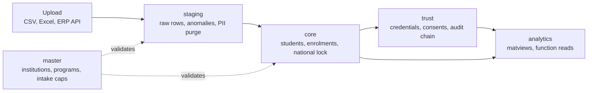
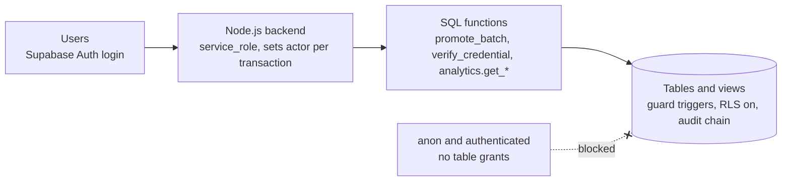
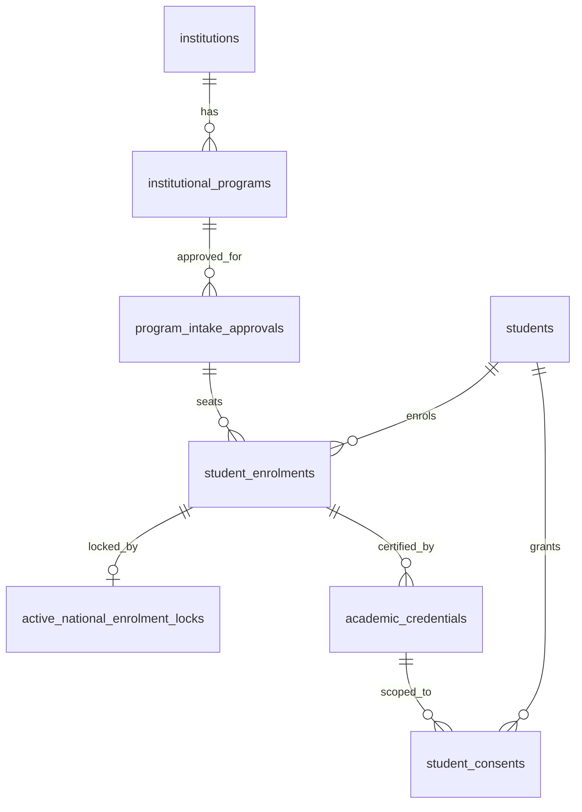

# AICTE National Enrolment Database: Schema, Access & Connections Reference

*Covers scripts 01 (master) to 05 (analytics) and patch 06 (v1.1). Target: Supabase / PostgreSQL 14+. Note: patch 06 was written from a static review and has not been executed against a database. Run it on staging first.*

## 1. Architecture at a glance

The database is split into five zones (schemas). Data flows one way: dirty data lands in `staging`, is verified and promoted into `core`, is certified in `trust`, and is summarised in `analytics`. `master` holds the AICTE reference data that everything is validated against. Diagrams for all of this are in the Visual maps appendix at the end.

| Zone | Schema | Purpose | Script |
| --- | --- | --- | --- |
| 1 | `master` | AICTE institutions, affiliating bodies, programs, annual intake approvals (seat caps), user profiles, quota-residency rules | 01, patch 06 |
| 2 | `staging` | Landing and quarantine: upload batches, raw rows, validation anomalies, PII purge | 02, patch 06 |
| 3 | `core` | Golden repository: verified students, foreign/NRI profiles, enrolments (partitioned), national locks, Stage 4 promotion | 03, patch 06 |
| 4 | `trust` | Verifiable credentials, consents, verifier organisations, hash-chained audit ledger | 04, patch 06 |
| 5 | `analytics` | Materialized views and scoped read functions for dashboards | 05 |

**Core design rules**

- **Backend-only access.** The Node.js backend connects as `service_role` (or `postgres`). RLS is ON everywhere; almost nothing has policies, so API roles are denied by default.
- **No foreign keys from `staging` to `core`.** Dirty data is never coupled to the golden repository. Links are soft references (e.g. `resolved_student_id`, `promoted_enrolment_id`).
- **All raw staging columns are TEXT** so every uploaded row lands, even malformed ones.
- **Sensitive proofs** (passport, FRRO, OCI card, sponsorship ref) are stored as BYTEA ciphertext produced app-side. The database never sees keys.
- **Append-only evidence.** Audit, verification logs, refresh log and enrolment status history cannot be updated, deleted or truncated.
- **Every function pins `search_path`** and uses qualified names.

## 2. Roles, connections and the actor contract

### 2.1 Database roles

| Role | Who uses it | What it can do |
| --- | --- | --- |
| `postgres` | Schema owner, migrations, pg\_cron | Everything. Owns all objects and SECURITY DEFINER functions. Run all scripts as this role. |
| `service_role` | Node.js backend / BullMQ workers | DML on most tables, EXECUTE on the API functions. Bypasses RLS. After patch 06: no TRUNCATE, REFERENCES or TRIGGER anywhere; restricted DELETE (see 2.4). |
| `authenticated` | Supabase logged-in end users via PostgREST | No table grants on any zone. Can EXECUTE only three master RLS helper functions. USAGE on schema `master` only (revoked on staging, core, trust by the patch; analytics revoked in script 05). |
| `anon` | Unauthenticated PostgREST | Nothing. No table privileges, no function EXECUTE. |
| `PUBLIC` | Implicit pseudo-role | EXECUTE stripped on all functions in master, staging, core, trust (patch) and analytics (script 05). |

### 2.2 Application roles (`master.user_role_enum`)

Stored in `master.user_profiles.role`, linked 1:1 to `auth.users`.

| App role | Scope column | What the database lets it do |
| --- | --- | --- |
| `AICTE_SUPER_ADMIN` | none (all) | Sees all analytics; can refresh analytics with force; counts as AICTE officer for verifier-org decisions; sees all via `master.can_read_institution`. |
| `AICTE_REGIONAL_OFFICER` | `aicte_region` | Analytics and master reads for institutions in their region; can decide verifier organisations; sees verification traffic and quota reconciliation for their region. Without a region: denied. |
| `AFFILIATING_BODY_REGISTRAR` | `affiliating_body_id` | Analytics and master reads for institutions under their body; may issue and change credentials for those institutions. |
| `INSTITUTION_NODAL_OFFICER` | `institution_id` | Own institution only; may issue and change credentials for it. |
| `EMPLOYER_VERIFIER` | via `trust.verifier_org_members` | Can call credential verification only as an active member of an APPROVED organisation. |
| `STUDENT` | via `core.student_accounts` | Linked to a `core.students` record (DigiLocker / OTP+eSign / admin verified). Used by the backend to resolve consent actions. |

### 2.3 How the backend connects

1. Backend connects with `service_role` through Supavisor (transaction pooling).
2. At the start of **every transaction** that touches credentials, verifier orgs, consents or verification, or that reads analytics, it runs: `SELECT set_config('app.actor_user_id', '<uuid>', true), set_config('app.request_id', '<id>', true);` The third argument must be `true` (transaction-local). A session-level SET would leak to the next client on a pooled connection.
3. Triggers read the actor through `trust.current_actor()` (validates UUID format) and `trust.current_request_id()` (max 100 chars).
4. After patch 06 the actor is **mandatory** (fail closed) for: `trust.assert_actor_matches`, inserts into `trust.student_consents` (`trg_consents_require_actor`) and `trust.employer_verification_logs` (`trg_vlogs_require_actor`).
5. `analytics.refresh_all()` is the one exception: no actor means system/cron, an actor must be an active super admin, and `force` needs an actor.
6. The BullMQ worker publishes Redis events only after the promotion transaction commits. Workers must retry on SQLSTATE `40P01` (deadlock).

### 2.4 Privilege model after all scripts

| Object group | `anon` | `authenticated` | `service_role` |
| --- | --- | --- | --- |
| master tables | none | none (RLS policies exist but are inert until SELECT is granted) | ALL minus TRUNCATE/REFERENCES/TRIGGER; no DELETE on institutions, programs, intake approvals, affiliating bodies; no write on `quota_residency_rules` |
| staging tables | none | none | ALL minus TRUNCATE/REFERENCES/TRIGGER |
| core tables | none | none | ALL minus TRUNCATE/REFERENCES/TRIGGER; no DELETE on `students` and `student_enrolments*`; `student_accounts` no UPDATE; `enrolment_status_history` SELECT/INSERT only |
| trust tables | none | none | see table 2.5 |
| analytics (matviews, refresh\_log) | none | none | **none** (reads only through functions) |
| functions | none | 3 master helpers only | EXECUTE on all in master, staging, core, trust; allow-list in analytics |

### 2.5 Trust schema grants (script 04)

| Table | service\_role grants |
| --- | --- |
| `verifier_organisations`, `academic_credentials`, `student_consents` | SELECT, INSERT, UPDATE |
| `verifier_org_members` | SELECT, INSERT, UPDATE, DELETE |
| `employer_verification_logs`, `immutable_audit_logs`, `audit_checkpoints` | SELECT, INSERT |
| `audit_chain_heads` | SELECT only (only the SECURITY DEFINER chain trigger writes it) |

### 2.6 Functions callable by each role

- **authenticated:** `master.current_user_institution_id()`, `master.current_user_role()`, `master.can_read_institution(uuid)`.
- **service\_role (analytics allow-list):** `get_seat_utilisation`, `get_enrolment_summary`, `get_pipeline_daily`, `get_anomaly_summary`, `get_credential_status`, `get_verification_daily`, `get_quota_reconciliation`, `public_national_summary`, `get_freshness`, `refresh_all`, `verify_analytics_security`.
- **Owner-only (analytics):** `current_scope`, `suppress_small`, `check_year`.
- **service\_role (all other schemas):** everything else, including `core.promote_batch`, `core.promote_program_batch`, `core.finalize_batch`, `core.create_enrolment_partition`, `core.ensure_enrolment_partitions`, `core.student_id_for_user`, `staging.purge_batch_pii`, `staging.purge_batch_identity`, `staging.run_retention`, all `trust.*` API functions, `master.verify_security_baseline`.

## 3. Zone 1: `master` (reference data)

### 3.1 Enums

| Enum | Values |
| --- | --- |
| `user_role_enum` | AICTE\_SUPER\_ADMIN, AICTE\_REGIONAL\_OFFICER, AFFILIATING\_BODY\_REGISTRAR, INSTITUTION\_NODAL\_OFFICER, EMPLOYER\_VERIFIER, STUDENT |
| `institution_category_enum` | CENTRAL\_UNIVERSITY, STATE\_UNIVERSITY, DEEMED\_TO\_BE\_UNIVERSITY, PRIVATE\_UNIVERSITY, AUTONOMOUS\_INSTITUTE, AFFILIATED\_COLLEGE, PGDM\_STANDALONE |
| `program_level_enum` | DIPLOMA, POST\_DIPLOMA, UG\_DEGREE, PG\_DEGREE, PGDM, FELLOWSHIP\_PHD |
| `program_shift_enum` | FIRST\_SHIFT, SECOND\_SHIFT, PART\_TIME, ODL\_ONLINE |
| `residency_status_enum` | INDIAN\_RESIDENT, NRI, OCI, PIO, FOREIGN\_NATIONAL, CIWGC |
| `seat_quota_type_enum` | REGULAR\_SANCTIONED, NRI\_QUOTA, SUPERNUMERARY\_TFW, SUPERNUMERARY\_FN\_OCI\_CIWGC, SUPERNUMERARY\_PMSSS, SUPERNUMERARY\_EWS, LATERAL\_ENTRY |

### 3.2 Tables

| Table | Key columns and rules |
| --- | --- |
| `affiliating_bodies` | PK `affiliating_body_id`; unique `aishe_code`; `body_type` check list; `nad_issuer_id` for DigiLocker/NAD. |
| `institutions` | PK `institution_id`; unique `aicte_permanent_id`, `aishe_code`; FK to affiliating body (RESTRICT); `aicte_region` check (8 regions); `approval_status` (EOA\_GRANTED, NO\_ADMISSION, WITHDRAWN, SUSPENDED). |
| `user_profiles` | PK/FK `user_id` to `auth.users` (CASCADE); `role`; optional `institution_id`, `affiliating_body_id` (SET NULL), `aicte_region`; `is_active`. |
| `institutional_programs` | PK `program_id`; FK institution (RESTRICT); unique `aicte_course_id`; unique (institution, level, shift, course\_name); **patch:** unique (`program_id`, `institution_id`) as FK target. |
| `program_intake_approvals` | One row per program per academic year (unique `program_id, academic_year`). Holds approved caps (sanctioned, NRI, TFW, FN/OCI/CIWGC, PMSSS, EWS, lateral), live counters (`actual_*_enrolled`), `admission_cutoff_date`, `is_locked_by_aicte`. |
| `quota_residency_rules` (patch) | PK (`seat_quota_type`, `residency_status`). A quota with rows is limited to the listed residencies; a quota with no rows is unrestricted. Seeded: NRI\_QUOTA to NRI/OCI/PIO; SUPERNUMERARY\_FN\_OCI\_CIWGC to FOREIGN\_NATIONAL/OCI/CIWGC. **Confirm against the current AICTE Approval Process Handbook.** |

### 3.3 Integrity added by the patch

- `fk_intake_program_institution`: intake approval's (program, institution) must match the program's real institution (added NOT VALID, then validated; NOTICE if legacy rows violate it).
- `chk_intake_nri_within_sanctioned`: NRI seats must not exceed sanctioned intake.
- `trg_intake_counter_guard` (BEFORE UPDATE): counters may only rise within caps. Regular + NRI must stay within sanctioned intake because NRI seats sit inside the sanctioned pool. Lowering a cap later never blocks other updates.
- `trg_intake_caps_audit` (AFTER UPDATE): any change to caps, lock flag, EoA ref or cut-off writes audit event `INTAKE.CAPS_CHANGED` to chain `app_master` (ids and numbers only).

### 3.4 Master RLS

RLS is enabled on all master tables. Policies `pol_institutions_read`, `pol_programs_read`, `pol_intake_read` (SELECT, `authenticated`) now call `master.can_read_institution(institution_id)`, a SECURITY DEFINER helper that resolves `auth.uid()` and applies: super admin sees all; nodal officer sees own institution; regional officer sees same `aicte_region`; registrar sees same `affiliating_body_id`; anyone else sees nothing. `user_profiles`, `affiliating_bodies` and `quota_residency_rules` have RLS on and no policies (deny all for API roles). Because `authenticated` has no table grants, these policies do nothing until you deliberately GRANT SELECT.

## 4. Zone 2: `staging` (landing and quarantine)

### 4.1 Enums

| Enum | Values |
| --- | --- |
| `submission_source_enum` | CSV\_UPLOAD, EXCEL\_UPLOAD, ERP\_API |
| `batch_status_enum` | UPLOADED, L1\_PROCESSING, L1\_COMPLETED, L2\_PROCESSING, L2\_COMPLETED, L3\_PROCESSING, COMPLETED, COMPLETED\_WITH\_ANOMALIES, FAILED, CANCELLED |
| `record_validation_status_enum` | PENDING, L1\_PASSED, L2\_VERIFIED, REJECTED, QUARANTINED, VALID |
| `anomaly_severity_enum` | ERROR, WARNING |
| `anomaly_code_enum` | 28 original codes across L1 (syntax/category/intra-batch), L2 (APAAR/ABC) and L3 (quota/lock), plus patch additions `DUPLICATE_ROLL_NO_IN_PROGRAM` and `QUOTA_RESIDENCY_MISMATCH` (added in their own committed transaction). |

### 4.2 Tables

| Table | Notes |
| --- | --- |
| `submission_batches` | One row per upload/ERP push. FK institution (RESTRICT), `submitted_by` to `user_profiles` (SET NULL). Counters (`total_rows`, `l1_rejected_rows`, `l2_quarantined_rows`, `l3_quarantined_rows`, `promoted_rows`) with a check that their sum cannot exceed total. Unique targets (`batch_id, institution_id`) and (`batch_id, institution_id, academic_year`). `pii_purged_at`; **patch:** `identity_purged_at`. |
| `staging_enrolment_records` | BIGINT identity PK for fast COPY. Composite FK (`batch_id, institution_id, academic_year`) to batches (CASCADE) so a row cannot carry another institution or year. About 22 TEXT `raw_*` columns, then normalised/resolved columns (`normalised_apaar_id`, `resolved_program_id`, `resolved_intake_approval_id`, `resolved_residency_status`, `resolved_quota_type`), ABC verification fields, pipeline state, `promoted_enrolment_id`. **Patch:** `resolved_student_id`, `resolved_admission_date` (Stage 4 could not run without them). A state-consistency CHECK ties `validation_status` to `rejected_at_level`, `promoted_at`, `promoted_enrolment_id`. |
| `validation_anomalies` | Structured per-row errors with `anomaly_code`, `severity`, `validation_level` (1-3), `field_name`, `offending_value`, `message`, `fix_hint`, `details` JSONB, optional `conflicting_institution_id`, resolution fields. Composite FKs ensure the record belongs to the same batch and the batch to the same institution. |

### 4.3 PII retention (two stages)

| Stage | Function | Clears | Default trigger |
| --- | --- | --- | --- |
| 1 | `staging.purge_batch_pii(batch)` | passport no/expiry, visa, FRRO, OCI, sponsor ref, email, mobile, `raw_payload`, plus matching keys in anomaly `details` and anomaly `offending_value` | 30 days after the batch finishes |
| 2 | `staging.purge_batch_identity(batch)` (patch) | APAAR (raw and normalised), name, DOB, gender, roll no, nationality, social category, residency, `abc_response_ref` | 180 days after the batch finishes |

Both only run on finished batches (COMPLETED, COMPLETED\_WITH\_ANOMALIES, FAILED, CANCELLED). `staging.run_retention(p_pii_days, p_identity_days)` loops over eligible batches; it requires `1 <= pii_days <= identity_days`. The 30/180 values are placeholders until your DPO decides.

## 5. Zone 3: `core` (golden repository)

### 5.1 Enums

- `apaar_verification_status_enum`: VERIFIED, EXEMPT\_FOREIGN\_PROVISIONAL, REVOKED.
- `enrolment_status_enum`: VERIFIED\_ACTIVE, GRADUATED, DROPPED\_OUT, TRANSFERRED\_OUT, WITHDRAWN.

### 5.2 Tables

| Table | Notes |
| --- | --- |
| `students` | PK `student_id`; unique `apaar_id` (12 digits); unique (`student_id, residency_status`) as target of the profile FK. Check: VERIFIED needs apaar\_id and verified time; EXEMPT\_FOREIGN\_PROVISIONAL only for FOREIGN\_NATIONAL; REVOKED needs apaar\_id. |
| `student_foreign_nri_profiles` | 1:1 with non-resident students. Composite FK (`student_id, residency_status`) to students (CASCADE both ways). BYTEA ciphertext columns for passport, FRRO, OCI, sponsorship; `passport_fingerprint` (HMAC, unique) for dedup without decryption. Category-specific proof checks (OCI needs card; FN needs visa or FRRO; CIWGC needs sponsorship). A deferred constraint trigger forces a profile to exist for any non-resident student by commit. |
| `student_enrolments` | **Partitioned by LIST (academic\_year).** PK (`enrolment_id, academic_year`). FKs to students, institutions, programs, intake approvals (all RESTRICT). `is_supernumerary_seat` is a generated column. Lateral entry must have `entry_year_of_study = 2`. Partial unique index: one active roll number per program per year. |
| `active_national_enrolment_locks` | One row per active full-time student (PK `student_id`, unique `apaar_id`, unique `enrolment_id`). Deferred FK to enrolments (CASCADE). This is what blocks a student being enrolled in two places. |
| `student_accounts` (patch) | PK/FK `user_id` to `auth.users` (CASCADE); unique FK `student_id` (RESTRICT); `link_method` DIGILOCKER / OTP\_ESIGN / ADMIN\_VERIFIED. Insert only for an active STUDENT profile; link is immutable afterwards. |
| `enrolment_status_history` (patch) | Append-only (identity PK) record of every status change with `changed_by` and `request_id`. |
| `student_enrolments_YYYY_YY` | Partitions, created by `core.create_enrolment_partition`. Initially 2024-25 to 2027-28; `ensure_enrolment_partitions(n)` keeps current year -1 up to +1+n ahead. |

### 5.3 Triggers on core

| Trigger | Fires | Effect |
| --- | --- | --- |
| `trg_students_updated_at`, `trg_foreign_profiles_updated_at`, `trg_enrolments_updated_at` | BEFORE UPDATE | Maintain `updated_at`. |
| `trg_students_require_profile`, `trg_profile_delete_requires_resident` | deferred, AFTER | Non-resident student must have a profile at commit. |
| `trg_enrolments_guard` (`enrolment_guard` v1.1) | BEFORE INSERT/UPDATE | Insert: intake approval must match institution/program/year; quota must be open to the student's residency (via `quota_residency_rules`). Update: identity, placement, quota, admission date and entry year immutable; an ended enrolment cannot return to VERIFIED\_ACTIVE. |
| `trg_locks_fill_apaar` | BEFORE INSERT on locks | Copies apaar\_id from students. |
| `trg_enrolments_release_lock` | AFTER UPDATE OF status | Deletes the lock when an enrolment leaves VERIFIED\_ACTIVE. |
| `trg_enrolments_require_lock` | deferred, AFTER | Every active enrolment must have a matching lock at commit. |
| `trg_locks_guard_delete` (patch) | deferred, AFTER DELETE on locks | A lock cannot vanish while its enrolment is still active. |
| `trg_enrolments_status_log` (patch) | AFTER UPDATE OF status | Writes `enrolment_status_history` and audit event `ENROLMENT.STATUS_CHANGED` (chain `app_core`). |
| `trg_students_identity_audit` (patch) | AFTER UPDATE on students | Audit event `STUDENT.IDENTITY_CHANGED` listing changed field names only, never values. |
| `trg_student_accounts_guard`, `trg_student_accounts_updated_at` (patch) | BEFORE | Link rules and timestamps. |
| `trg_enrol_hist_immutable`, `trg_enrol_hist_no_truncate` (patch) | BEFORE | Append-only history. |

## 6. Stage 4 promotion (core functions)

`core.promote_batch(batch)` is the entry point. It marks the batch L3\_PROCESSING, quarantines rows with no resolved program (`UNKNOWN_PROGRAM`), then calls `core.promote_program_batch(batch, program)` once per program in stable order, then calls `core.finalize_batch`. In v1.1 a retry on an already finished batch returns `already_finalised: true` instead of raising.

`promote_program_batch` is one atomic unit (one program of one batch), in the caller's transaction:

| Step | What happens | Anomaly code |
| --- | --- | --- |
| 0 | Validate batch status (L2\_COMPLETED or L3\_PROCESSING). `SELECT ... FOR UPDATE` on the program's intake row, which serialises concurrent uploads for that program and year. Intake must match the batch's institution. No intake or AICTE-locked: quarantine all rows and return. | PROGRAM\_NOT\_APPROVED\_FOR\_YEAR, PROGRAM\_LOCKED\_BY\_AICTE |
| 1a | Student not in `core.students` | APAAR\_NOT\_FOUND (level 2) |
| 1b | APAAR revoked | APAAR\_INACTIVE (level 2) |
| 1c | Quota type unresolved | INVALID\_SEAT\_QUOTA\_TYPE |
| 1c2 (new) | Quota not open to student's residency | QUOTA\_RESIDENCY\_MISMATCH |
| 1f | Same student twice in the program of this batch | DUPLICATE\_APAAR\_IN\_BATCH |
| 1h (new) | Already enrolled with same student/institution/program/year/quota: accepted as an idempotent no-op (marked VALID, counted as `already_enrolled`) | none |
| 1d | Missing or unreadable admission date | MISSING\_REQUIRED\_FIELD |
| 1e | Admission after cut-off (IST date) | ADMISSION\_AFTER\_CUTOFF |
| 1g | Roll number reused in upload or by another active student of the program/year | DUPLICATE\_ROLL\_NO\_IN\_PROGRAM |
| 2 | Reserve enrolment ids, insert national locks ordered by student\_id (consistent order avoids deadlocks). Students already locked anywhere are quarantined. | CROSS\_INSTITUTION\_DUPLICATE\_ENROLMENT |
| 3a | NRI sub-cap in source-row order | EXCEEDS\_NRI\_QUOTA |
| 3b | Sanctioned pool: regular + NRI must fit in sanctioned intake | EXCEEDS\_SANCTIONED\_INTAKE |
| 3c | Each supernumerary bucket and lateral entry against its own cap | EXCEEDS\_SUPERNUMERARY\_\*, EXCEEDS\_LATERAL\_ENTRY\_INTAKE |
| 4 | Insert enrolments (lateral gets entry year 2), mark staging rows VALID, bump master counters | none |

Over-cap rows release their locks. The function returns JSON with promoted, already\_enrolled, quarantined, per-code and per-quota counts. `finalize_batch` refuses to finish while any row is still PENDING, L1\_PASSED or L2\_VERIFIED, then sets COMPLETED (all rows valid) or COMPLETED\_WITH\_ANOMALIES and writes the final counters.

## 7. Zone 4: `trust` (credentials, consent, audit)

### 7.1 Enums

| Enum | Values |
| --- | --- |
| `credential_type_enum` | DEGREE\_CERTIFICATE, DIPLOMA\_CERTIFICATE, PROVISIONAL\_CERTIFICATE, SEMESTER\_MARKSHEET, ENROLMENT\_PROOF, TRANSFER\_CERTIFICATE |
| `credential_status_enum` | ISSUED, SUSPENDED, REVOKED, SUPERSEDED |
| `consent_purpose_enum` | EMPLOYMENT\_VERIFICATION, HIGHER\_EDUCATION\_ADMISSION, SCHOLARSHIP\_ELIGIBILITY, GOVERNMENT\_SCHEME\_BENEFIT, DIGILOCKER\_ISSUANCE |
| `consent_status_enum` | GRANTED, WITHDRAWN (expiry is derived from `expires_at`) |
| `consent_channel_enum` | DIGILOCKER, STUDENT\_APP, OTP\_ESIGN |
| `disclosure_category_enum` | CREDENTIAL\_VALIDITY, PROGRAM\_DETAILS, GRADES, ENROLMENT\_STATUS |
| `verifier_org_type_enum` | EMPLOYER, BGV\_AGENCY, EDUCATIONAL\_INSTITUTION, GOVERNMENT\_AGENCY, DIGILOCKER\_PLATFORM |
| `verifier_org_status_enum` | PENDING, APPROVED, SUSPENDED, REVOKED |
| `verification_outcome_enum` | VERIFIED, NOT\_FOUND, ID\_MISMATCH, CONSENT\_REQUIRED, CREDENTIAL\_REVOKED, CREDENTIAL\_SUSPENDED, CREDENTIAL\_SUPERSEDED, CREDENTIAL\_OUTSIDE\_VALIDITY, ORG\_NOT\_APPROVED, REQUESTER\_NOT\_AUTHORISED, RATE\_LIMITED |

### 7.2 Tables and their state machines

| Table | Rules |
| --- | --- |
| `verifier_organisations` | Starts PENDING. Allowed moves: PENDING to APPROVED/REVOKED; APPROVED to SUSPENDED/REVOKED; SUSPENDED to APPROVED/REVOKED. The decision must be by an active AICTE officer who equals the session actor. Identity columns are immutable (name and type editable only while PENDING). No delete. |
| `verifier_org_members` | PK `user_id` (FK to user\_profiles, CASCADE); FK org (RESTRICT). Only active EMPLOYER\_VERIFIER users. Only `is_active` can change. |
| `academic_credentials` | W3C Verifiable Credential with dual ID. Signing happens app-side (KMS); `credential_hash` is unique. Insert: issuer must be nodal officer of that institution or registrar of its body; student APAAR must be VERIFIED; type must match enrolment status (degree/diploma/provisional need GRADUATED, enrolment proof needs VERIFIED\_ACTIVE, transfer needs TRANSFERRED\_OUT, marksheet allows active, graduated or transferred); `printed_apaar_id` and `printed_student_roll_id` are copied from core and cannot be chosen. After issue only status columns can change. Transitions: ISSUED to SUSPENDED/REVOKED/SUPERSEDED; SUSPENDED to ISSUED/REVOKED/SUPERSEDED. SUPERSEDED happens only by re-issue (inner trigger depth). A status reason of at least 10 characters is required for any non-ISSUED state. One live credential per enrolment, type and period (partial unique index). |
| `student_consents` | Insert as GRANTED only. Grantee org must be APPROVED. A scoped credential must belong to the consenting student and be ISSUED. `granted_at` is forced to now(); expiry must be within 1 year. Under 18 (IST) needs guardian consent plus guardian hash. `consent_artifact_hash` is unique (replay protection). Explicit scope: one credential XOR all credentials. Update allows withdrawal only (GRANTED to WITHDRAWN). |
| `employer_verification_logs` | Append-only. Stores only whether presented IDs matched, never the presented values. A VERIFIED outcome requires a consent id. |
| `immutable_audit_logs`, `audit_chain_heads`, `audit_checkpoints` | See 7.4. |

### 7.3 API functions

| Function | Purpose |
| --- | --- |
| `trust.set_credential_status(credential, new_status, actor, reason)` | Suspend, revoke or restore a credential (the guard trigger enforces the rules). |
| `trust.withdraw_consent(consent, student, channel)` | Withdraw a consent; the student id is resolved from the caller's session, so one student cannot withdraw another's consent. |
| `trust.verify_credential(credential, org, requester, purpose, apaar, roll, fingerprint)` | One atomic check. Order: org approved, requester is an active org member, rate limit (20 failures per hour per org), credential lookup with FOR SHARE, **both IDs must match before anything about consent or status is revealed**, consent lookup (FOR SHARE), credential state and validity window, then log. Returns a coarse public result (VERIFIED, CONSENT\_REQUIRED, RATE\_LIMITED, NOT\_AUTHORISED, NOT\_VALID, NOT\_VERIFIED). NOT\_FOUND and ID\_MISMATCH look identical to the caller; the precise outcome is only in the log. |
| `trust.log_audit_event(...)` | Application audit writer; only `app_*` chains are free-form. |
| `trust.verify_audit_chain(chain, from, to)` and `verify_all_audit_chains()` | Recompute hashes; check gaps, head agreement and checkpoints. |

### 7.4 Tamper-evident audit ledger

- `audit_chain_before_insert` is the only SECURITY DEFINER function in trust. It computes seq, prev\_hash, occurred\_at, actor, actor role, db role, request id, payload text and row hash, discarding whatever the caller sent. It locks the chain head FOR UPDATE, so seq equals commit order with no gaps.
- Hash: SHA-256 over prev\_hash plus length-prefixed canonical fields (`trust.audit.v1`). The payload is frozen as text.
- Reserved chains (`credentials`, `consents`, `verifier_orgs`, `verifications:0` to `verifications:15`) can be written only from inside other triggers (trigger depth 2 or more). `app_*` chains are for the backend; the patch uses `app_master` and `app_core`.
- Payload guard: max 16 KB and no keys that look like personal data (passport, email, mobile, name, DOB, address, aadhaar and similar).
- `audit_checkpoints`: backend-signed (KMS) checkpoints of (chain, seq, head hash), validated against the actual row. This is what makes a full-chain rewrite by a DBA detectable, ideally with an anchor outside the database.
- Automatic audit events: `CREDENTIAL.ISSUED`, `CREDENTIAL.STATUS_CHANGED`, `CONSENT.GRANTED`, `CONSENT.WITHDRAWN`, `VERIFIER_ORG.REGISTERED`, `VERIFIER_ORG.STATUS_CHANGED`, `VERIFICATION.<outcome>`.
- Verification traffic is spread across 16 chains by hashing the org id. A transaction should write to one chain; if it must touch several, take them in alphabetical order.

## 8. Zone 5: `analytics` (dashboards)

Materialized views cannot carry RLS, so **nobody** (anon, authenticated, service\_role) has table privileges on them. Every read goes through a SECURITY DEFINER function that resolves the caller from the actor setting and filters by scope.

### 8.1 Views and read functions

| Materialized view | Content | Read function | Audience |
| --- | --- | --- | --- |
| `mv_seat_utilisation` | Caps vs actuals per intake approval, fill %, `over_sanctioned_flag`, `policy_cap_flag` | `get_seat_utilisation(year, institution, only_flagged, limit, offset)` | Scoped |
| `mv_enrolment_summary` | Counts by quota, residency, status | `get_enrolment_summary(year, institution, limit, offset)` | Scoped |
| `mv_pipeline_daily` | Batches and promotion rate per institution per IST day | `get_pipeline_daily(from, to, institution, limit, offset)` | Scoped; max 366-day range |
| `mv_anomaly_summary` | Anomaly counts by code, severity, level, month | `get_anomaly_summary(year, institution, only_unresolved, limit, offset)` | Scoped |
| `mv_credential_status` | Credential counts by type and status | `get_credential_status(year, institution, limit, offset)` | Scoped |
| `mv_verification_daily` | National verification traffic by org type, purpose, outcome | `get_verification_daily(from, to, limit, offset)` | AICTE officers only |
| `mv_quota_reconciliation` | Master counters vs truth in core, with drift flags | `get_quota_reconciliation(year, only_drift, limit, offset)` | AICTE officers (regional: own region) |
| derived from `mv_enrolment_summary` | Public national figures, cells under 10 hidden, rounded to 5, fixed grain | `public_national_summary(year)` | No actor needed |

The scope predicate is the same everywhere: `s_all OR institution = s_institution OR region = s_region OR body = s_body`. NULL never matches, so a missing scope value cannot widen access. An out-of-scope institution filter returns an empty result (no error), so ids cannot be probed.

### 8.2 Safeguards

- Limit clamped to 1-500, offset to 0-100000, `statement_timeout` 10 s on reads; academic year validated by regex.
- A unique index on every matview (required for `REFRESH ... CONCURRENTLY`).
- `refresh_all(force)`: advisory lock, 30-second throttle per view, each view refreshed in its own sub-block, results written to the append-only `refresh_log` (SQLSTATE only, never message text). 10-minute timeout. Views refresh one after another, so they can differ by a few seconds; compare `computed_at` if it matters.
- `get_freshness()` shows the age of each view. All day and month buckets use Asia/Kolkata.
- No student-level or contact columns in any view; `verify_analytics_security()` scans every matview column name for personal-data patterns.
- `verify_analytics_security()` and `master.verify_security_baseline()` return one row per failed control; an empty result means healthy.

## 9. Foreign key and reference map

| From | To | On delete |
| --- | --- | --- |
| institutions.affiliating\_body\_id | affiliating\_bodies | RESTRICT |
| user\_profiles.user\_id | auth.users | CASCADE |
| user\_profiles.institution\_id / affiliating\_body\_id | institutions / affiliating\_bodies | SET NULL |
| institutional\_programs.institution\_id | institutions | RESTRICT |
| program\_intake\_approvals.program\_id / institution\_id | institutional\_programs / institutions | RESTRICT |
| program\_intake\_approvals (program\_id, institution\_id) | institutional\_programs (program\_id, institution\_id) | RESTRICT (patch) |
| submission\_batches.institution\_id | institutions | RESTRICT |
| submission\_batches.submitted\_by | user\_profiles | SET NULL |
| staging\_enrolment\_records (batch, institution, year) | submission\_batches | CASCADE |
| validation\_anomalies (record\_id, batch\_id) | staging\_enrolment\_records | CASCADE |
| validation\_anomalies (batch\_id, institution\_id) | submission\_batches | CASCADE |
| validation\_anomalies.conflicting\_institution\_id / resolved\_by | institutions / user\_profiles | SET NULL |
| student\_foreign\_nri\_profiles (student\_id, residency\_status) | students | CASCADE |
| student\_enrolments.student / institution / program / intake | students / institutions / programs / intake approvals | RESTRICT |
| active\_national\_enrolment\_locks.student / institution / program | students / institutions / programs | RESTRICT |
| active\_national\_enrolment\_locks (enrolment\_id, academic\_year) | student\_enrolments | CASCADE, deferred |
| student\_accounts.user\_id / student\_id | auth.users / students | CASCADE / RESTRICT |
| academic\_credentials.student / institution / program | students / institutions / programs | RESTRICT |
| academic\_credentials (enrolment\_id, academic\_year) | student\_enrolments | RESTRICT |
| academic\_credentials.supersedes\_credential\_id | academic\_credentials | RESTRICT |
| verifier\_org\_members.user\_id / verifier\_org\_id | user\_profiles / verifier\_organisations | CASCADE / RESTRICT |
| student\_consents.student / grantee\_org / scope\_credential | students / verifier\_organisations / academic\_credentials | RESTRICT |
| employer\_verification\_logs.verifier\_org\_id / consent\_id | verifier\_organisations / student\_consents | RESTRICT |

**Deliberate soft references (no FK):** staging to core (`resolved_student_id`, `promoted_enrolment_id`); enrolments to staging (`source_batch_id`, `source_record_id`); audit rows to users, institutions and students; `issued_by`, `status_changed_by`, `decided_by`, `requested_by`; `refresh_log.triggered_by`; `enrolment_status_history.changed_by`.

## 10. Operations runbook

**Deploy order:** 01 master, 02 staging, 03 core, 04 trust, 05 analytics, then 06 patch (Part A in its own transaction, then Part B). The patch is safe to re-run. After every deploy run `SELECT * FROM master.verify_security_baseline();` and `SELECT * FROM analytics.verify_analytics_security();` (both must return no rows), and run your 04b and 05b test suites.

**Suggested pg\_cron schedule (adjust before enabling):**

| Job | Cron | Call |
| --- | --- | --- |
| analytics-refresh | `*/15 * * * *` | `SELECT analytics.refresh_all()` |
| staging-retention | `30 2 * * *` | `SELECT staging.run_retention(30, 180)` |
| enrol-partitions | `0 3 1 * *` | `SELECT core.ensure_enrolment_partitions(4)` |
| security-baseline | `0 4 * * *` | `SELECT * FROM master.verify_security_baseline()` |

**Rules for future migrations:** end each migration with `REVOKE ALL ON ALL FUNCTIONS IN SCHEMA ... FROM PUBLIC, anon, authenticated;` then `GRANT EXECUTE ... TO postgres, service_role;`, because schema default privileges cannot remove PUBLIC's implicit EXECUTE. Set any new integrity trigger to `ENABLE ALWAYS`. Logical restores (pg\_dump / pg\_restore) now run the integrity triggers, so prefer point-in-time or physical restores.

## 11. Findings and open items

**Observed while consolidating (worth checking):**

1. **New partitions regain DELETE.** Patch section 9.1 revokes DELETE on `student_enrolments` and the partitions that exist at that moment. A partition created later (for example by the monthly `ensure_enrolment_partitions` job) gets service\_role default privileges, which still include DELETE. Fix: add a `REVOKE DELETE ON core.%I FROM service_role` step to `core.create_enrolment_partition`, and extend `verify_security_baseline` to flag it.
2. **Master helper search\_path.** Script 01 created `current_user_institution_id` and `current_user_role` with `search_path = master, public`; the patch pins them to `pg_catalog, pg_temp`. Both use qualified names, so this should be safe, but confirm with the baseline check.
3. **Actor is now mandatory.** After the patch, any backend path that inserts consents or verification logs, issues credentials or decides verifier orgs without setting `app.actor_user_id` will fail. Update the backend transaction wrapper first.
4. **Policies are inert by design.** Master RLS policies do nothing while `authenticated` has no grants. If you ever expose master data through PostgREST, grant SELECT deliberately and re-test region and registrar scoping.
5. **Patch status.** It has not been executed. NOT VALID constraints may stay unvalidated if legacy data violates them (a NOTICE is raised).

**Decisions the scripts leave open (from the patch header):** counters never decrement on withdrawal; part-time and ODL exemption from the national lock; audit-chain sharding for credentials and consents; HMAC vs plain SHA-256 chain; DPDP erasure design; dedicated least-privilege database roles (the patch still assumes `service_role`); retention periods; the quota-residency seed rules.

## Appendix: Visual maps

### A. Zone data flow

Uploads land in staging, core promotes only verified rows, trust certifies them, and analytics summarises. Master is consulted at every validation step.

### B. Connection and permission path

Users never touch the database directly. The backend, as service\_role, calls functions that enforce scope, and anon and authenticated stay blocked at the table level.

### C. Main foreign-key relationships

Arrows point to the referenced table. Enrolments, credentials, consents and locks also reference institutions and programs; the full list is in section 9.
