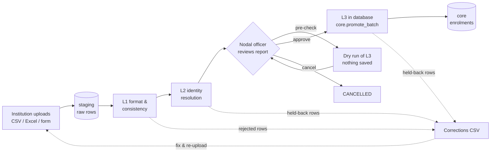

# Ingestion & Validation

How student enrolment data gets from an institution into the AICTE central repository: upload, validation, approval, commit. This covers the backend modules, the background jobs, the frontend screens and how to run them.

Follows the "Student Data Upload & Validation Pipeline" in [APAAR_Platform_Architecture.drawio](APAAR_Platform_Architecture.drawio).

---

## 1. The flow at a glance



| Step | Runs in | What it does |
|---|---|---|
| **Upload** | API | Parses the file, maps column headers, stores every row as raw text in `staging.staging_enrolment_records`, creates a `staging.submission_batches` row, queues a validation job. Returns HTTP 202. |
| **L1** | Background job | Format, category and in-batch checks. Failing rows → `REJECTED`. |
| **L2** | Background job | Matches each row to a student in `core.students` (or creates one). Identity problems → `QUARANTINED`. |
| **Approval** | Institution (UI) | Maker-checker step. The batch waits at `L2_COMPLETED` until the nodal officer approves. |
| **L3** | Database | The existing `core.promote_batch` function: seat caps, national lock, cut-off, commit. **Not reimplemented in the app.** |

---

## 2. Setup

### Environment (`backend/.env`)

| Variable | Needed for | Notes |
|---|---|---|
| `DATABASE_URL` | everything | Supabase session pooler URL. |
| `SUPABASE_URL`, `SUPABASE_ANON_KEY`, `SUPABASE_SERVICE_ROLE_KEY` | login | All ingestion/validation routes require a signed-in user. |
| `REDIS_URL` | background jobs | For Upstash use the **TCP** URL, not the REST URL: `rediss://default:<token>@<host>.upstash.io:6379`. **Leave empty** to run jobs inside the API process (fine for local development). |
| `WORKER_IN_API` | background jobs | Default `true`: the API starts a worker itself. Set `false` if you run `npm run dev:worker` as a separate process. |
| `FIELD_ENCRYPTION_KEY` | NRI / OCI / PIO / FN / CIWGC students | Base64 32-byte key. Without it, any batch containing non-resident students fails with a clear message. **Generate once and share the same key with the whole team**, because data encrypted with one key cannot be read with another. |

Generate the encryption key:

```bash
node -e "console.log(require('crypto').randomBytes(32).toString('base64'))"
```

### Database

Scripts 01–06 must already be applied (they are on the shared Supabase project). One extra patch is needed for **form entry** only:

```sql
-- database/db_scripts/ingestion_patch.sql
ALTER TYPE staging.submission_source_enum ADD VALUE IF NOT EXISTS 'WEB_FORM';
```

Until it is applied, CSV and Excel uploads work but form submissions fail with a message pointing at this file.

Uploads also need reference data: the institution in `master.institutions`, its programs in `master.institutional_programs` (matched on `aicte_course_id`), and an intake approval per program and year in `master.program_intake_approvals`. Without an intake approval, L3 holds rows back as `PROGRAM_NOT_APPROVED_FOR_YEAR`.

### Run

```bash
cd backend  && npm run dev          # API (+ worker, or inline jobs without REDIS_URL)
cd backend  && npm run dev:worker   # optional separate worker (set WORKER_IN_API=false)
cd frontend && npm run dev          # http://localhost:5173
```

---

## 3. File structure

```
backend/src/
  config/redis.ts                       Redis connection for BullMQ
  db/pool.ts                            pg pool (staging/core are raw SQL, not Prisma)
  db/transaction.ts                     withTransaction(), setActor() for audit triggers
  lib/crypto/field-encryption.ts        AES-256-GCM field encryption + HMAC fingerprints
  integrations/apaar-registry/index.ts  APAAR registry interface (DigiLocker plugs in here)
  modules/auth/institution-access.ts    who may see / act on an institution's batches
  modules/ingestion/
    columns.ts                          canonical fields + header aliases
    parsers.ts                          CSV (csv-parse) and XLSX (exceljs) readers
    ingestion.service.ts                create batch, bulk insert rows, queue validation
    ingestion.routes.ts                 /api/v1/ingestion/*
  modules/validation/
    normalise.ts                        pure parsers: APAAR, dates, residency, quota, country…
    name-match.ts                       order-insensitive name similarity
    l1-rules.ts                         pure L1 rules + in-batch duplicate detection
    anomalies.ts                        bulk insert into staging.validation_anomalies
    stages/l1.stage.ts                  L1 against the database
    stages/l2.stage.ts                  L2 identity resolution
    stages/l3.stage.ts                  calls core.promote_batch; dry-run forecast
    pipeline.ts                         stage orchestration, resume after failure
    validation.service.ts               report, anomaly list, corrections CSV, approve/cancel/retry
    validation.routes.ts                /api/v1/validation/*
  jobs/
    queues/validation.queue.ts          BullMQ queue (inline fallback without Redis)
    processors/validation.processor.ts  job handler + worker
    worker.ts                           standalone worker entry point
  utils/http-error.ts

backend/tests/unit/validation/l1-rules.test.ts

frontend/src/
  api/download.ts                       authenticated file downloads
  features/upload/                      CSV / Excel upload, form entry, IngestionPanel
  features/validation/
    api.ts, types.ts, anomaly-labels.ts
    components/BatchValidationReport.tsx  the report (polls while processing)
    components/BatchStatusStepper.tsx     5-step progress bar
    components/AnomalyTable.tsx           paginated issues with fix hints
    components/ApprovalPanel.tsx          pre-check, approve, cancel

database/db_scripts/ingestion_patch.sql   adds WEB_FORM source channel
```

---

## 4. Upload

Three ways in, all producing one batch:

| Method | Source channel | Limits |
|---|---|---|
| CSV upload | `CSV_UPLOAD` | 25 MB, 50,000 rows |
| Excel upload (`.xlsx` only; first visible sheet) | `EXCEL_UPLOAD` | 25 MB, 50,000 rows |
| Web form | `WEB_FORM` | 500 students per submission |

- **Column headers** are matched loosely: case, spaces and punctuation are ignored, and common aliases work (`APAAR ID`, `apaar_no`, `Student Name`, `DOB`, `Roll Number`, `Course Code`…). Unrecognised columns are kept in `raw_payload`. A file with no APAAR ID or name column is refused.
- **Templates** (`GET /ingestion/template?format=csv|xlsx`) list the 21 standard columns. The Excel template formats every column as text so APAAR IDs keep all 12 digits.
- **Duplicate files**: the same file (SHA-256) uploaded twice for an institution is refused with 409, unless the user chooses "upload again anyway".
- `source_row_number` is the real line/row number in the file, so errors point back to the spreadsheet.

---

## 5. Validation checks

Every issue is a row in `staging.validation_anomalies` with a code, severity, level, message and fix hint. **ERROR** blocks the row; **WARNING** is shown but the row continues.

### L1: format and consistency (app)

| Code | When |
|---|---|
| `MISSING_REQUIRED_FIELD` | Name, date of birth, roll no., program code or admission date missing/unreadable; nationality missing for OCI/PIO/FN. *Warning* for an unrecognised gender. |
| `MISSING_APAAR_ID` | No APAAR ID (only Foreign Nationals may omit it). |
| `INVALID_APAAR_FORMAT` | Not 12 digits. Spots Excel scientific notation (`1.23E+11`) and says how to fix it. |
| `INVALID_DATE_OF_BIRTH` | Not a real date, in the future, before 1930, or under 10 at admission. *Warning* when age is unusual for the program level (e.g. under 16 for UG, over 65). |
| `INVALID_RESIDENCY_STATUS` | Residency not recognised. |
| `OCI_FN_STATUS_CONFLICT` | Marked both FN and OCI; flags contradict residency; FN with Indian nationality; flag not Y/N. |
| `INVALID_SEAT_QUOTA_TYPE` | Quota not recognised; EWS supernumerary seat for a non-EWS student. Blank quota means regular sanctioned seat. |
| `MISSING_PASSPORT_DETAILS` | Non-resident without passport; FN without visa type or FRRO no. *Warning* if the passport expired before admission. |
| `MISSING_OCI_DETAILS` | OCI without OCI card no. |
| `MISSING_EMBASSY_SPONSORSHIP` | CIWGC without sponsorship reference. |
| `UNKNOWN_PROGRAM` | Program code not an active program of the institution. |
| `DUPLICATE_APAAR_IN_BATCH` | Same student twice in the upload (APAAR, or passport for FN without APAAR). First row kept. |
| `DUPLICATE_ROLL_NO_IN_BATCH` | Same roll number twice in the upload. First row kept. |

Dates accept `YYYY-MM-DD`, `DD/MM/YYYY`, `DD-MM-YYYY`, `DD.MM.YYYY` and Excel serial numbers. Numeric dates are read **day-first**; `MM/DD/YYYY` is not supported.

### L2: identity (app)

| Situation | Result |
|---|---|
| APAAR already in `core.students` | Date of birth must match exactly and name similarity must be ≥ 0.8 (word order and titles ignored). Otherwise `APAAR_DEMOGRAPHIC_MISMATCH`. A different residency is a *warning*; the registered value is used. |
| APAAR not yet in the repository | Looked up in the APAAR registry, then a `core.students` row is created as `VERIFIED`. |
| Foreign National without APAAR | Matched on passport fingerprint, else created as `EXEMPT_FOREIGN_PROVISIONAL`. |
| Passport already belongs to another student | `APAAR_DEMOGRAPHIC_MISMATCH`. |
| Registry says not found / inactive / unreachable | `APAAR_NOT_FOUND` / `APAAR_INACTIVE` / `ABC_VERIFICATION_UNAVAILABLE` (only once a registry is connected). |

Non-resident students get a `core.student_foreign_nri_profiles` row in the same transaction. Passport, FRRO, OCI card and sponsorship numbers are encrypted app-side (AES-256-GCM); the passport also gets an HMAC fingerprint so duplicates are found without decrypting.

### L3: repository (database, unchanged)

Run by `core.promote_batch` after approval: `PROGRAM_NOT_APPROVED_FOR_YEAR`, `PROGRAM_LOCKED_BY_AICTE`, `APAAR_INACTIVE`, `QUOTA_RESIDENCY_MISMATCH`, `ADMISSION_AFTER_CUTOFF`, `DUPLICATE_ROLL_NO_IN_PROGRAM`, `CROSS_INSTITUTION_DUPLICATE_ENROLMENT`, `EXCEEDS_SANCTIONED_INTAKE`, `EXCEEDS_NRI_QUOTA`, `EXCEEDS_SUPERNUMERARY_*`, `EXCEEDS_LATERAL_ENTRY_INTAKE`. Rows that pass become `core.student_enrolments` and the intake counters go up. See `database/db_architecture.md` §6.

---

## 6. Approval (maker-checker)

When L2 finishes, the batch waits at `L2_COMPLETED`. In the report the nodal officer can:

- **Run pre-check**: executes `core.promote_batch` inside a transaction and rolls it back, showing how many rows would be enrolled, already enrolled or held back, and why. Nothing is saved.
- **Approve & submit**: requires ticking a confirmation. Moves the batch to `L3_PROCESSING` atomically (a second click gets 409), writes `BATCH.APPROVED` to the `app_ingestion` audit chain, and queues promotion.
- **Cancel batch**: allowed from `UPLOADED`, `L1_COMPLETED`, `L2_COMPLETED` or `FAILED`.

---

## 7. Batch statuses

```
UPLOADED → L1_PROCESSING → L1_COMPLETED → L2_PROCESSING → L2_COMPLETED  (awaiting approval)
        → L3_PROCESSING → COMPLETED | COMPLETED_WITH_ANOMALIES
FAILED      infrastructure error; Retry resumes from where the rows actually are
CANCELLED   cancelled by the institution
```

Each stage runs in a single transaction and only touches rows in its input state, so a crashed or retried job picks up where it left off. BullMQ retries a job 3 times with backoff before marking the batch `FAILED`. A missing encryption key fails immediately without retries. A batch that failed during promotion goes back to awaiting approval rather than being promoted automatically. If the queue can't be reached at upload time, the rows are kept and the batch is marked `FAILED` so it can be retried without re-uploading.

---

## 8. API

All routes need `Authorization: Bearer <token>` and are limited to **AICTE super admins** and the **institution's own nodal officer**.

### `/api/v1/ingestion`

| Method & path | Purpose |
|---|---|
| `GET /institutions` | Institutions the user can submit for. |
| `GET /fields` | Canonical field list and required fields. |
| `GET /template?format=csv\|xlsx` | Blank template. |
| `POST /preview` | Multipart `file`. Column mapping and first 10 rows; writes nothing. |
| `POST /upload` | Multipart `file`, `institutionId`, `academicYear` (`2026-27`), optional `allowDuplicate=true`. → 202 + batch. |
| `POST /form` | JSON `{ institutionId, academicYear, records: [...] }`. → 202 + batch. |
| `GET /batches?institutionId=` | Recent batches. |
| `GET /batches/:id` | One batch. |

### `/api/v1/validation`

| Method & path | Purpose |
|---|---|
| `GET /batches/:id` | Batch, row counts by status, anomaly summary, registry mode. |
| `GET /batches/:id/anomalies` | Paginated issues. Query: `severity`, `level`, `code`, `page`, `pageSize` (≤ 200). APAAR IDs masked. |
| `GET /batches/:id/corrections.csv` | Rejected/held-back rows in template column order plus `_source_row`, `_status`, `_problems`. Fix and re-upload. |
| `POST /batches/:id/precheck` | Dry-run forecast (only at `L2_COMPLETED`). |
| `POST /batches/:id/approve` | Approve and queue promotion. |
| `POST /batches/:id/cancel` | Cancel. |
| `POST /batches/:id/retry` | Retry a `FAILED` batch. |

---

## 9. Frontend

In the **Institution portal → Batch Ingestion & Uploads** tab (the header's "Upload" and "Add Student" buttons open it too):

1. Pick institution (locked to their own for nodal officers) and academic year.
2. Choose CSV, Excel or form. File uploads show the column mapping and a preview before submitting.
3. After submitting, the **validation report** opens and refreshes every 3 seconds while processing:
   - 5-step progress bar
   - tiles for rows received / rejected / held back / ready or committed
   - issue chips by type, a paginated table with fix hints, error/warning filter
   - "Download rows to correct (CSV)"
   - the approval panel when the batch is ready, or Retry when it failed
4. **Recent Submissions** lists every batch; click one to open its report.

APAAR IDs are masked (`XXXX XXXX 9012`) on screen. The corrections CSV contains the institution's own full values so it can be re-uploaded.

---

## 10. Testing

```bash
cd backend && npx vitest run tests/unit     # L1 rules, normalisers, name matching (10 tests)
```

The full pipeline was also run once against the live Supabase schema inside a rolled-back transaction: 12 rows → 6 rejected at L1, 1 identity mismatch at L2, 1 over intake at L3, 4 committed (regular, FN without APAAR, NRI, existing student). It confirmed the pre-check forecast, double-approval refusal, intake counters, encrypted profiles, the audit entry and the deferred profile constraint. Nothing was left in the database.

**Not yet tested:** BullMQ against Upstash, signed-in API calls, and the UI in a browser.

---

## 11. Known limitations

- **No DigiLocker / ABC check yet.** New students are recorded as declared by the institution (`abc_response_ref = 'SELF_DECLARED'`), and the report says so. Existing students are still matched on name and date of birth. To connect it, implement `ApaarRegistry.lookupMany` in `backend/src/integrations/apaar-registry/index.ts`; L2 already handles `FOUND`, `NOT_FOUND`, `INACTIVE` and `UNAVAILABLE`.
- **Approver is the nodal officer.** The diagram has a separate Director with OTP/DSC sign-off; the database has no such role yet.
- **Not built:** regional officer review queue, anomaly/risk scoring (spikes, shared contact clusters), notifications/webhooks.
- **Upstash bills per command.** The worker polls every 30 s when idle (`drainDelay`) to keep usage low.
- **Social category, email and mobile** are uploaded and checked but not stored in `core` (no columns there).
- **Seat counters never decrease** when a student withdraws. This is a database design decision still open (`db_architecture.md` §11).

---

## 12. Troubleshooting

| Symptom | Cause / fix |
|---|---|
| Batch `FAILED`: "FIELD_ENCRYPTION_KEY must be…" | Set the shared key in `backend/.env`, restart, click Retry. |
| Form submit: "need the WEB_FORM source channel" | Run `database/db_scripts/ingestion_patch.sql`. |
| Batch stuck at `UPLOADED` | No worker running: check `REDIS_URL`, or that `WORKER_IN_API` isn't `false` without `npm run dev:worker`. |
| Every row `UNKNOWN_PROGRAM` | Program codes must equal `aicte_course_id` in `master.institutional_programs` for that institution. |
| Every row held back as `PROGRAM_NOT_APPROVED_FOR_YEAR` | No `master.program_intake_approvals` row for that program and academic year. |
| APAAR IDs like `1.23457E+11` | Excel converted them; format the column as Text (the Excel template already does). |
| 401 / "Authentication service is temporarily unavailable" | `SUPABASE_*` keys missing from `backend/.env`. |
